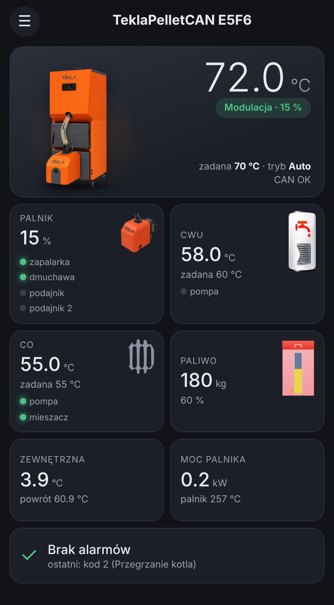
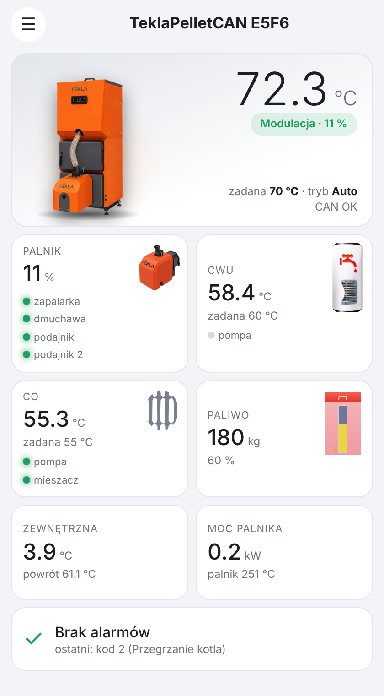
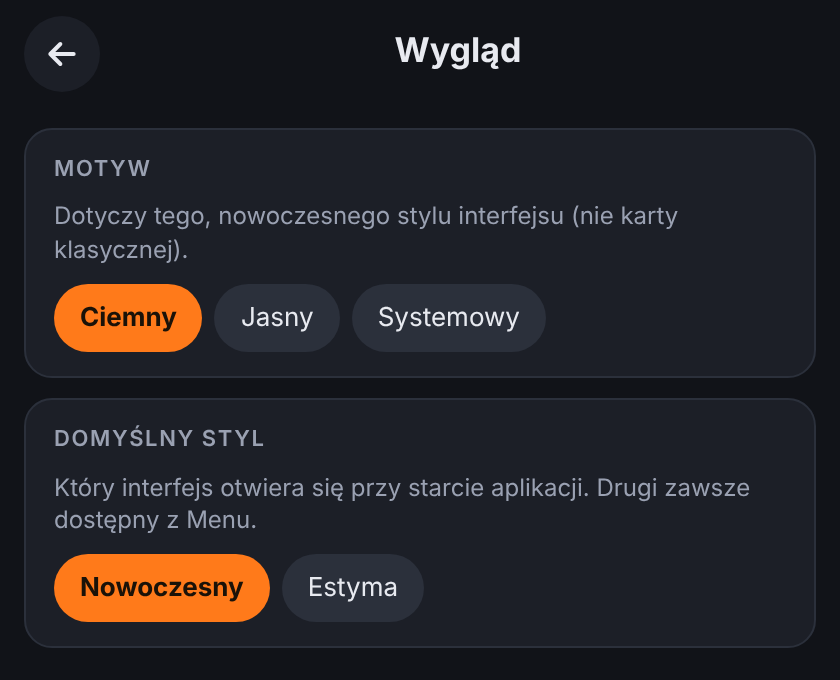
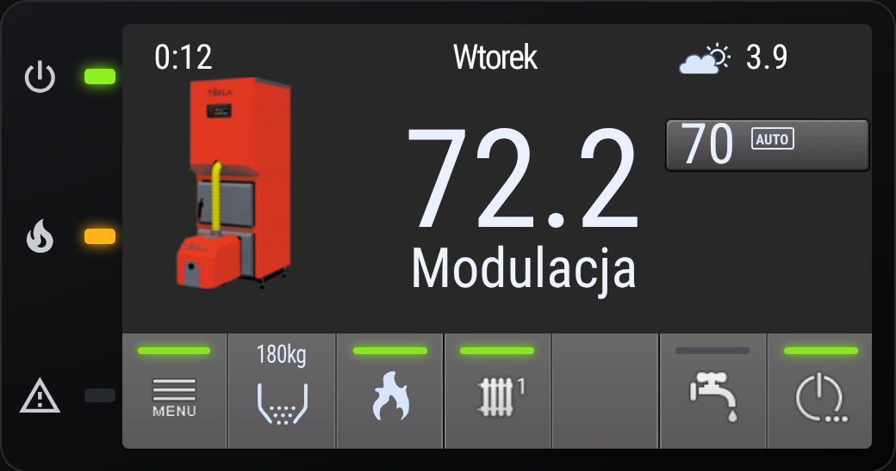

# TeklaPelletCAN

Własny firmware (ESP-IDF, C++) dla ESP32-C6 z modułem CAN (MCP2515), który czyta i zapisuje parametry kotła pelletowego
Tekla/Estyma po magistrali CAN (CANopen SDO, węzeł 4, 125 kbit/s) i udostępnia je przez REST API, własną stronę WWW
(interfejs jak w aplikacji Android), integrację Home Assistant i aplikację Android.

To jest repozytorium **rozwojowe** — tu powstaje firmware, integracja, karty i aplikacja. Gotowe wydania trafiają też
do osobnych, dedykowanych repozytoriów (patrz niżej), żeby każdy element dało się zainstalować niezależnie.

## Elementy projektu

| Co | Gdzie zainstalować | Źródło w tym repo |
|---|---|---|
| Firmware (ESP32-C6) | [Wydania tego repo](../../releases) – wgrywane przez USB lub OTA | `firmware/` |
| Integracja Home Assistant (HACS) | [GieOeRZet/TeklaPelletCAN_HA](https://github.com/GieOeRZet/TeklaPelletCAN_HA) | `custom_components/teklapelletcan/` |
| Karta classic (replika panelu Igneo Touch) | [GieOeRZet/TeklaPelletClassic-card](https://github.com/GieOeRZet/TeklaPelletClassic-card) | `web/teklapelletclassic-card.js` (jedyny zasób HA), `web/teklapelletclassic-engine.js`, `web/tekla-panel-card.js` |
| Karta modern (styl aplikacji Android) | [GieOeRZet/TeklaPelletModern-card](https://github.com/GieOeRZet/TeklaPelletModern-card) | `web/teklapelletmodern-card.js` |
| Aplikacja Android | [GieOeRZet/TeklaPelletDroid](https://github.com/GieOeRZet/TeklaPelletDroid) | `android/` |

Portal urządzenia (`http://<adres-urządzenia>/`) działa od razu, bez żadnej z powyższych instalacji — serwowany jest
bezpośrednio przez samo urządzenie i ma ten sam interfejs co aplikacja Android.

Ekrany Kocioł/Palnik/Ogrzewanie/Ciepła woda (aplikacja Android, portal urządzenia) mają tę samą kolejność ustawień
i te same poziomy dostępu PIN co fizyczny panel kotła. Styl interfejsu (Nowoczesny / Estyma – replika oryginalnego
panelu) oraz motyw (ciemny / jasny / wg systemu) ustawia się w Menu → Wygląd; ustawienie zapisuje się na urządzeniu
z którego korzystasz.

<p>
  
  
  
</p>
<p>
  
</p>

## Jak to działa (komunikacja)

```
Kocioł (CANopen, węzeł 4) ─CAN 125 kbit/s─ MCP2515 ─SPI─ ESP32-C6
                                                            │
                                     REST API + WebSocket (http://<adres-urządzenia>/api/v1/...)
                                                            │
                        ┌───────────────────────────────────┼───────────────────────────────────┐
                        ▼                                    ▼                                    ▼
              przeglądarka (portal/karta             integracja Home Assistant          aplikacja Android
                 urządzenia, ten sam               (encje + usługi, wykrywanie          (natywny proxy +
                  silnik co karty HA)                przez zeroconf lub IP)              cache + tryb demo)
```

Urządzenie **nie łączy się z internetem** — każdy klient (przeglądarka, HA, aplikacja) ustawia mu czas przy
połączeniu. Zapis parametru zawsze wymaga poziomu dostępu (PIN jak w panelu kotła) i tokenu parowania klienta;
sam odczyt jest dostępny bez parowania (opcja do wyłączenia). Pełny opis API i bezpieczeństwa:
[docs/ARCHITEKTURA.md](docs/ARCHITEKTURA.md) §7–8, oraz szczegóły rzeczywistej implementacji w
[DOKUMENTACJA/FIRMWARE.md](DOKUMENTACJA/FIRMWARE.md).

## Dokumentacja

- [DOKUMENTACJA/](DOKUMENTACJA/README.md) — mapa bitmap panelu, architektura karty Classic, rzeczywista
  architektura firmware/Android/integracji HA (uzupełnienie poniższych dokumentów o szczegóły wypracowane
  podczas rozwoju).
- [rejestry/](rejestry/README.md) — **pełna dokumentacja rejestrów kotła** (CANopen, kodowanie wartości,
  dekompilacja firmware panelu Igneo Touch, metodologia skanowania różnicowego).
- [docs/ARCHITEKTURA.md](docs/ARCHITEKTURA.md) — ogólna architektura projektu, API, bezpieczeństwo, OTA.
- [docs/PIERWSZE_URUCHOMIENIE.md](docs/PIERWSZE_URUCHOMIENIE.md), [docs/BUDOWANIE.md](docs/BUDOWANIE.md),
  [docs/WGRANIE_ZDALNE.md](docs/WGRANIE_ZDALNE.md).

## Jak zacząć

1. Wgraj firmware na ESP32-C6 (patrz [docs/BUDOWANIE.md](docs/BUDOWANIE.md)).
2. Połącz się z siecią Wi-Fi `TeklaPelletCAN-XXXX` wystawianą przez urządzenie i skonfiguruj hasło + Wi-Fi domowe.
3. Otwórz `http://<adres-urządzenia>/` w przeglądarce — gotowe, sterowanie działa od razu.
4. Opcjonalnie: zainstaluj integrację Home Assistant i/lub kartę, i/lub aplikację Android z repozytoriów w tabeli wyżej.

Pełny opis architektury: [docs/ARCHITEKTURA.md](docs/ARCHITEKTURA.md).

## Zastrzeżenia

Projekt jest niezależny i nieoficjalny, niezwiązany z firmami Tekla (producent kotłów) ani Estyma (producent
sterowników). **TeklaPelletCAN nie jest zamiennikiem oryginalnego sterownika kotła** — to dodatkowe urządzenie
podłączane do tej samej magistrali CAN, służące wyłącznie do odczytu i zapisu parametrów przez Home Assistant.
Podłączenie i zapis parametrów odbywa się na własne ryzyko i może naruszać warunki gwarancji producenta oraz prowadzić
do uszkodzenia lub nieprawidłowej pracy kotła/sterownika. Licencja: [LICENSE](LICENSE).
